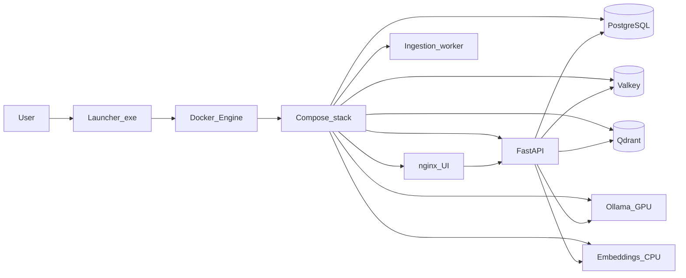

# План: админ-UI, лаунчер 1A, Windows+Linux

## Решения (зафиксировано)

- **Запуск:** один лаунчер (Tauri или аналог) → проверяет Docker/GPU → `compose up` → открывает `http://127.0.0.1:8080` → стоп/статус/логи.
- **Платформы v1:** Windows + Linux (NVIDIA). macOS не в scope.
- **Runtime внутри:** Docker Compose (как сейчас), не монолитный бинарник со всеми сервисами.
- **WSL на текущем ПК** остаётся рабочим хостом Windows; лаунчер абстрагирует «Engine доступен» (Engine в WSL или нативный Linux Docker).

## Что добавить в требования

Обновить пару документов (только ветка RTX5060Ti):

- [ROADMAP_local_RAG_RTX5060Ti_16GB.md](D:\RAG%205060\ROADMAP_local_RAG_RTX5060Ti_16GB.md)
- [CODEX_CURSOR_PROMPT_RTX5060Ti_16GB.md](D:\RAG%205060\CODEX_CURSOR_PROMPT_RTX5060Ti_16GB.md)

Новые блоки (кратко):

1. **F11 Admin Console (P0 после S1 shell):** экраны System / Storage / Models / Jobs / Chat (существующий UX расширить).
2. **F12 Launcher (P0):** `apps/launcher` — один артефакт сборки Win `.exe` и Linux binary/AppImage; команды start/stop/status; без ручного compose для пользователя.
3. **F13 Model Hub:** список моделей Ollama; import GGUF (локальный файл → volume → `ollama create`); download by URL с прогрессом и checksum; переключение активной модели + healthcheck; выгрузка предыдущей из VRAM.
4. **Portability:** portable bundle = лаунчер + `docker-compose.yml` + configs + `.env.example` + скрипт экспорта образов (опционально offline pack); данные на настраиваемом data root.

Также обновить [docs/adr/0001](D:\RAG%205060\docs\adr\0001-engine-wsl-broker-ui.md) → ADR 0002 (launcher + admin + model hub) и [docs/backlog.md](D:\RAG%205060\docs\backlog.md).

## Целевая архитектура

**UI (React+Vite+MUI, локальная статика):**

| Раздел | Функции |
|--------|---------|
| Dashboard | health сервисов, очередь, 1×LLM slot, RSS/VRAM/disk (через admin API) |
| Documents / Chat | как в MVP roadmap |
| Storage | originals/extracted/volumes usage, cleanup tombstones, browse protected files |
| Models | active model, pull tag, upload GGUF, URL import, switch + smoke test |
| System | start/stop hints, compose profile, logs tail (safe), offline mode flag |

Все действия только через `/api/admin/*` с ролью admin; UI не ходит напрямую в Ollama/Qdrant.

**Model Hub (GGUF/URL):**

- Upload GGUF → `models/imports/` volume → generate Modelfile → `ollama create <name>`.
- URL download → тот же pipeline + размер/таймаут/отмена job.
- Активная модель в DB/config; chat/generation читают её; `num_ctx=4096`, parallel=1 сохраняются.
- После switch: unload old → load new → generate smoke → health green/red.

**Launcher (`apps/launcher`):**

- Tech: Tauri 2 (Rust) или тонкий Go — выбрать Tauri для нативного UI «статус» + tray optional; минимум: CLI+GUI start.
- Preflight: Docker reachable, GPU (если есть), free disk, ports 8080 free.
- Embeds/рядом кладёт compose project dir; data root env `RAG_DATA_ROOT`.
- Win: предпочитает Docker Engine (в т.ч. через WSL distro Ubuntu-24.04); не требует Docker Desktop как единственный путь.
- Linux: нативный Docker Engine + NVIDIA toolkit.
- One-click: Start → wait healthy → open browser; Stop → compose down (volumes сохраняются).

## Порядок работ (после утверждения плана)

1. **Документы:** вписать F11–F13, экраны админки, portability, launcher DoD в roadmap + prompt + ADR0002 + backlog.
2. **Добить S1 runtime (уже начато):** Ollama ≥0.12.6, `qwen3:8b`, GPU generate smoke; API `/api/health`+nginx shell уже в черновике — довести `compose up` api/nginx.
3. **Admin API + UI Dashboard/System** (метрики compose/health/disk/queue).
4. **Storage UI** + API списка originals/usage.
5. **Model Hub** (list/switch/pull; затем GGUF+URL jobs).
6. **Launcher** Win+Linux сборки + README «один файл / одна кнопка».
7. **S2** вертикальный срез RAG (auth→upload→chat) параллельно не блокировать админкой после health.

## Критерии приёмки новых требований

- Двойной клик/`./RAG5060` на Win и Linux поднимает стек и открывает UI без ручного compose.
- Админ видит статус всех core-сервисов и базовую нагрузку (очередь, disk, VRAM/GPU если доступно).
- Можно сменить LLM: Ollama tag **или** локальный GGUF **или** URL; после смены chat использует новую модель.
- Перенос: архив portable + data root; на второй машине с Docker+NVIDIA — тот же лаунчер стартует (образы pull или offline pack).
- C: ≥50 ГБ на текущем ПК; тяжёлые данные на D: / настраиваемый data root.

## Вне scope v1

- macOS, Kubernetes, настоящий single-binary monolith без Docker.
- Автоустановка драйверов NVIDIA / Docker с нуля «в один клик» на голой ОС (лаунчер даёт понятный preflight и ссылки).
